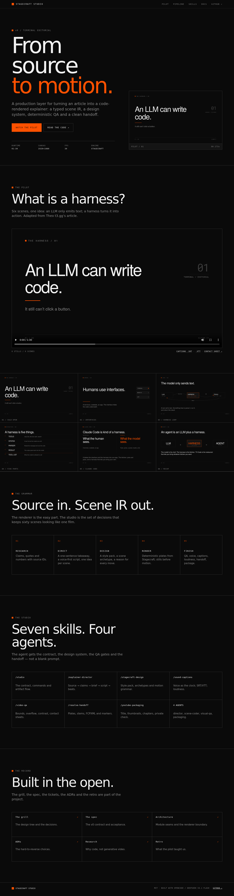

# Stagecraft Studio

**From a source article to a code-rendered educational motion graphic.**

[](https://gerrcass.github.io/stagecraft-studio/)

[Live demo](https://gerrcass.github.io/stagecraft-studio/) · [Watch the pilot](public/demo/theo-harness.mp4) · [Docs](docs/spec.md) · [Issues](https://github.com/gerrcass/stagecraft-studio/issues)

Stagecraft Studio is a production layer around Stagecraft (a private engine, not linked here).
It turns a source into a teaching spine, a voice-first script, a typed scene IR, a deterministic
motion-graphic composition, captions, a QA report and a Resolve/ffmpeg handoff.

It is built for one creator working with an AI agent, not for a render farm. The renderer is the easy
part; the studio is the set of decisions that keeps sixty AI-generated scenes looking like one film.

## The pilot

The first pilot is a **90-second explainer** of Theo t3.gg’s “What is a harness?” article: an LLM only
emits text; a harness parses it, runs tools and returns results; an agent is an LLM plus a harness.

- **Video:** [`public/demo/theo-harness.mp4`](public/demo/theo-harness.mp4) (1920×1080, 30 fps, 90.2 s)
- **Poster:** [`public/demo/poster.png`](public/demo/poster.png)
- **Contact sheet:** [`public/demo/contact-sheet.png`](public/demo/contact-sheet.png)
- **Captions:** [`public/demo/theo-harness.srt`](public/demo/theo-harness.srt)
- **Handoff:** [`handoff/`](handoff/) — manifest, FCPXML, markers, stems, note

The checked-in MP4 is the demo. The Stagecraft engine is a separate private project and is not
vendored here; the public site never imports it.

## The pipeline

```text
source → claims → brief → script → beats
       → scene IR (typed, validated) → compiler → Stagecraft layers
       → stills → deterministic QA → contact sheet
       → voice → alignment → captions → mix
       → plates + stems + FCPXML + manifest
       → ffmpeg master (default) / Resolve Studio (optional)
       → title + thumbnails + description + chapters
```

Human gates sit at brief, script, storyboard, picture lock and final. The agent does the mechanical
70–85%; the last 15–30% is taste, sound and editing.

## Quick start

```bash
npm install
npm run check          # typecheck, agent-env check, tests, site build
npm run dev            # local site
npm run build          # static site
```

The full render needs a Stagecraft checkout:

```bash
# 1. Generate the scratch voice with Kokoro (local Python venv)
python3 -m venv .venv
.venv/bin/pip install kokoro-onnx soundfile
HYPERFRAMES_PYTHON="$PWD/.venv/bin/python" npm run tts

# 2. Render the silent composition + stills + final mix
npm run render:pilot

# 3. QA and the Resolve/ffmpeg handoff
npm run qa
npm run handoff
```

`npm run render:pilot` looks for `../../../video/dist/cli.js` by default. Set `STAGECRAFT_ROOT` to a
Stagecraft checkout or `STAGECRAFT_CLI` to its CLI. The checked-in demo is already rendered, so the
site and tests work without the engine.

## The studio

- **Scene IR** — a typed contract between the director and the renderer, validated before code.
- **Terminal-editorial style pack** — tokens, type scale, grid, motion grammar and eight archetypes.
- **Seven skills** — `studio`, `explainer-director`, `stagecraft-design`, `sound-captions`,
  `video-qa`, `resolve-handoff`, `youtube-packaging`.
- **Four agents** — director, scene-coder, visual-qa, packaging. All use
  `opencode-go/deepseek-v4.1-flash#max`.
- **QA** — bounds, overflow, collisions, type floor, contrast, phone-width stills, caption timing, loudness and contact sheets.
- **Handoff** — master, stems, captions, FCPXML, markers, manifest and a note.

Open the repo in OpenCode; `opencode.json` selects the model and loads the skills. Start with:

```text
/studio
```

## Documentation

- [`docs/grilling.md`](docs/grilling.md) — the design tree and decisions.
- [`docs/spec.md`](docs/spec.md) — the v0 contract and acceptance.
- [`docs/architecture.md`](docs/architecture.md) — module seams and the renderer boundary.
- [`docs/adr/`](docs/adr/) — the hard-to-reverse choices.
- [`docs/research.md`](docs/research.md) — why code, not generative video.
- [`GLOSSARY.md`](GLOSSARY.md) — the shared language.
- [`CODING_STANDARDS.md`](CODING_STANDARDS.md) — what reviewers enforce.

## Limits

- The voice is a Kokoro scratch take; replace it with a human recording before publishing.
- The music is a generated scratch bed, not a licensed track.
- The demo is 90 seconds; a 5–12 minute episode needs chaptering and a longer edit.
- The engine is private; this repo is the studio layer and the evidence.

## License

MIT. Stagecraft is a separate private project. The source article and the reference clip belong to
their creator; the pilot is an original adaptation, not a copy of their assets.
